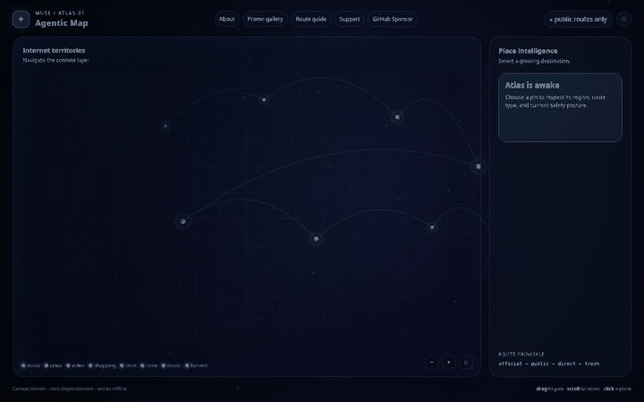
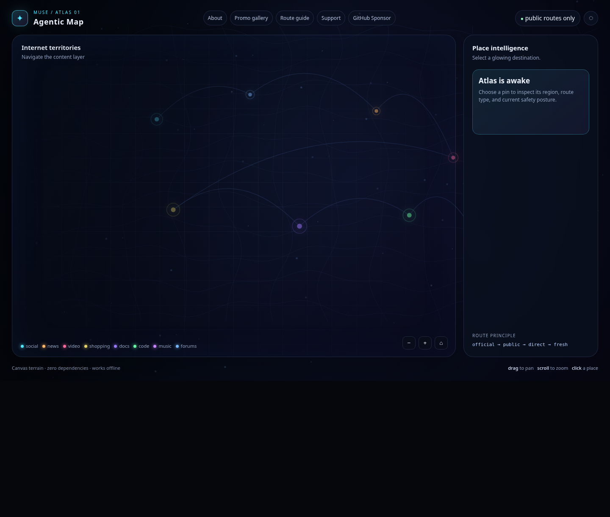
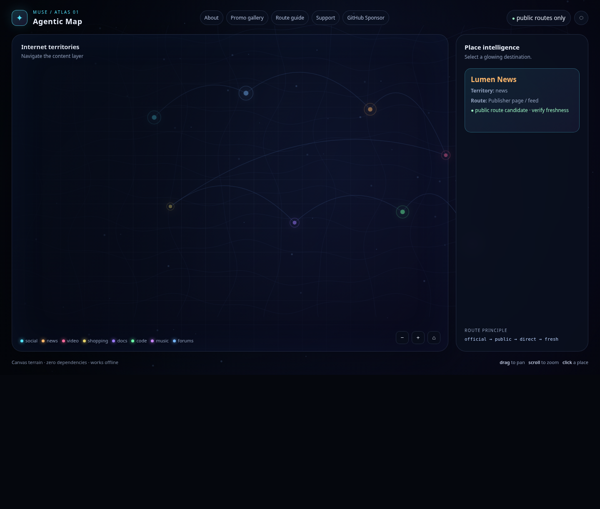
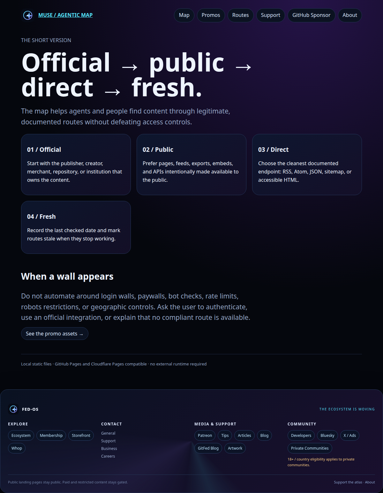
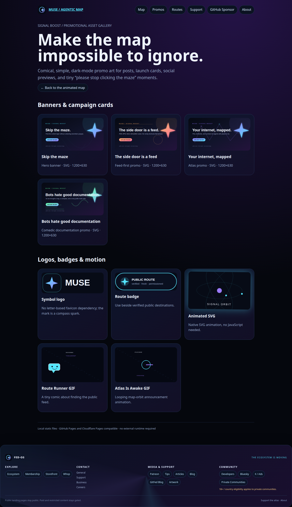

# Muse AI Agentic Map

[](LICENSE.md)

A dependency-free, dark interactive map for exploring public internet routes by territory instead of by search-result rank.

> **Official → public → direct → fresh.**

## Why this exists

The web often makes the useful part harder to reach than it needs to be: noisy landing pages, scattered feeds, unclear route health, and access controls that are easy to misunderstand. That creates repetitive work for people and agents who only need the underlying public content.

This repository makes that work easier in two complementary ways:

- a **human map** that turns destinations into glowing places, territories, and route corridors;
- an **agent map** that records route types, freshness, blockers, and safe shortcuts in plain Markdown.

It is intentionally different from a scraper or a circumvention tool. It favors documented APIs, RSS/Atom feeds, sitemaps, official embeds, public exports, licensed clients, and transparent limitations. It does not authorize bypassing authentication, paywalls, bot challenges, rate limits, robots rules, geographic controls, or terms of service.

## See it work

**Quickest demo:** open [`map/human/index.html`](map/human/index.html) in a browser. It is the real application entry point and needs no install step.



The live-demo link is intentionally not included: this repository does not currently publish a verified public URL. It is compatible with GitHub Pages and Cloudflare Pages as a static site, but deployment is not enabled by this archive.

### Run it locally

```bash
# from the repository root
python3 -m http.server 8000
```

Then open <http://localhost:8000/map/human/index.html>.

You can also open the HTML file directly with no server. The local server is useful when testing browser behavior consistently.

### Try the main examples

- [Animated human map](map/human/index.html) — pan, zoom, and select a glowing place.
- [Agent master index](map/agent/index.md) — start a structured route lookup.
- [Route guide](map/human/routes.html) — see the four-step route principle.
- [Promo gallery](map/human/promos.html) — inspect the repository’s banners, logos, SVG motion, and GIF assets.
- [Payment center](map/human/payments.html) — separate age-gated subscription, donation, and card tabs.

## Screenshots

### The map at a glance



### Selecting a destination



### Route guidance



### Promotion asset gallery



## Quick start

### Install

There is nothing to install. This is a static HTML and Markdown repository with no package manager, build system, or runtime dependency.

### Run

```bash
python3 -m http.server 8000
# open http://localhost:8000/map/human/index.html
```

### Test the static files

There is no automated test suite yet. A lightweight integrity check is:

```bash
python3 - <<'PY'
from pathlib import Path

root = Path('.')
required = [
    'map/human/index.html',
    'map/human/promos.html',
    'map/human/routes.html',
    'map/human/favicon.svg',
    'map/human/assets/demo/demo.gif',
]
missing = [p for p in required if not (root / p).exists()]
if missing:
    raise SystemExit(f'Missing required files: {missing}')
print('Static smoke check passed')
PY
```

## Repository tour

```text
map/human/       Interactive map, static pages, favicon, and visual assets
map/agent/       Master index, regions, routes, blockers, shortcuts
clients/         Client evaluation notes and search workflow
data/            Survey queues and route-status lists
docs/            Human and agent explanations
```

### Human view

The human map is one self-contained HTML page. Canvas draws the animated terrain, particles, route arcs, and pulsing destination pins in the browser. The page includes local navigation to the route guide, promo gallery, support pages, age gate, sponsor page, and private-community disclosure page.

### Agent view

The agent view is deliberately plain. Read `map/agent/index.md`, narrow by region, inspect a route, check known blockers, then use a documented shortcut only when it is public and permitted.

## Static deployment

No GitHub Actions workflow or live deployment configuration is present in this archive. The repository can be served as static files by GitHub Pages or Cloudflare Pages without a build command. The quickest published entry point would be:

```text
/map/human/index.html
```

For a root-level landing page, add a hosting-specific redirect or copy the human entry point into the published root; do not treat deployment as verified until the hosted URL has been tested.

## Payments and gated areas

`map/human/payments.html` contains separate Subscription, Donations, and Card tabs using the supplied payment-provider embeds. The page includes an 18+ self-attestation overlay, but that browser gate is not identity verification.

Payment UI is not the same as secure entitlement gating. Protected content needs server-side webhook verification and signed access sessions in a Cloudflare Worker or equivalent backend. Never place secret payment keys in static files.

The private Matrix destination is intentionally excluded from the public footer. [`private-communities.html`](map/human/private-communities.html) applies the project’s 18+ checkbox and country-eligibility flow before revealing it.

## Safety and freshness

A route that stops working should be marked `stale`, `blocked`, or `retired`, not silently left in the atlas. When a destination is restricted, ask the user to authenticate or use an official integration. Keep provenance, route type, last-checked date, attribution, privacy, and rate-limit behavior visible.

## License

MIT. See [`LICENSE.md`](LICENSE.md).


## Email-list access

[`join.html`](map/human/join.html) is the supplied FEDPromptly email-list page. It uses the browser-safe Supabase publishable key from the attachment for sign-up, sign-in, password reset, session detection, and logout. The page loads Supabase and the Inter font from external CDNs, so those features require network access.

Before production use, configure the Supabase project's Site URL and redirect URLs for the final GitHub Pages or Cloudflare Pages origin, enable the desired email-confirmation policy, and verify the database/auth policies. No Supabase secret key is included in this repository.


## Community invite

[`invite.html`](map/human/invite.html) contains the supplied animated FedPromptly community invite widget: a compact status button, native dialog modal, responsive community card, contact links, and a link to the external community page. The widget uses the supplied remote logo image and external FedPromptly links, so those parts require network access.
